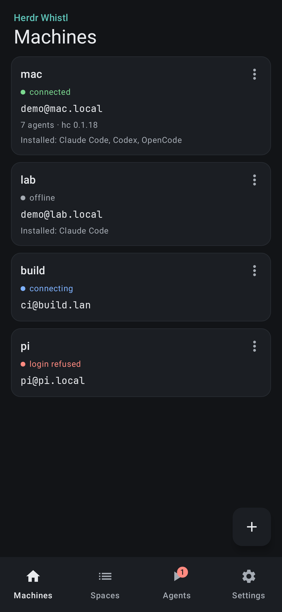
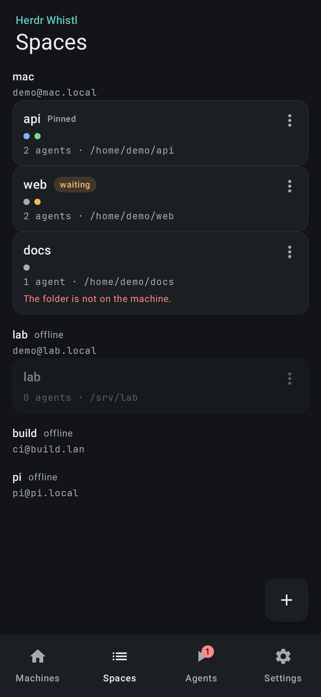
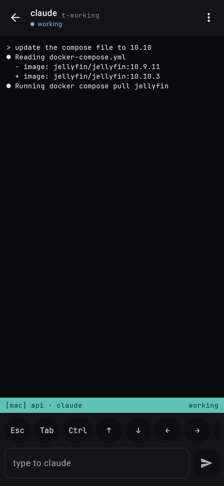
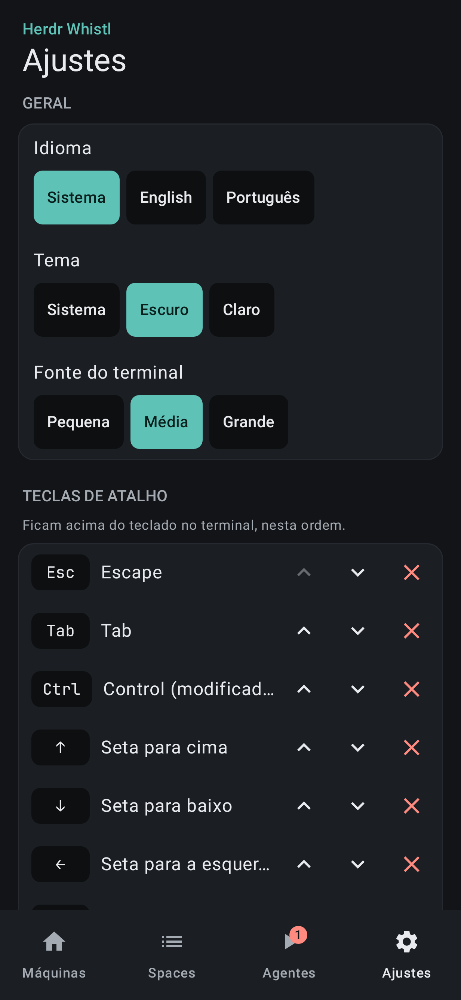

# Herdr Whistl

A minimalist Android app to coordinate coding agents running in
[Herdr](https://herdr.dev)'s herdr-core on your own machines.

The phone talks straight to each machine's herdr-core over SSH: no server, no account, no
telemetry.

<p>
  
  
  
  
</p>

## What it does

- **Machines** — add a computer you reach over SSH (a server, a Raspberry Pi, your Mac), confirm
  its host key on first connection, and see the agents installed there.
- **Spaces** — group work by a folder on one machine: pin, order, rename, close.
- **Agents** — every agent on every connected machine, filtered by what needs you, with a badge
  for agents that are blocked.
- **Terminal** — a tmux-style screen over the real terminal: monospace output, a status bar, and a
  shortcut key bar with a sticky `Ctrl`. No chat UI in between.
- **Settings** — language (System / English / Português), terminal font size, theme, and which
  shortcut keys sit in the bar.

Agents you start from Herdr desktop are matched to a space on the same machine by their working
folder; anything else shows under "No space".

## Requirements

- Android 8.0 (API 26) or newer.
- On each machine: SSH access and herdr-core (`hc`, measured against 0.1.18).

## Build

The project has no server component. Builds go through `scripts/gradle`, which prefers a native
JDK 17 plus Android SDK and only falls back to the pinned container:

```sh
scripts/gradle check assembleDebug      # unit tests + lint + debug APK
scripts/gradle recordRoborazziDebug     # screenshot goldens (macOS; see CONTRIBUTING.md)
```

Native toolchain: `brew install openjdk@17 && brew install --cask android-commandlinetools`, then
`sdkmanager "platforms;android-35" "build-tools;35.0.0" "platform-tools"`.

Container path (CI and machines without an SDK): `docker/android-build/`, amd64 because Android's
`aapt2` has no `linux/arm64` build.

## How it is built

Single `:app` module, Kotlin, Jetpack Compose, Material 3, coroutines and Flow, unidirectional data
flow. `docs/SPEC.md` is the product and technical spec; `AGENTS.md` holds the working rules.

```
ui/          screens, components, theme, navigation; one ViewModel per screen
domain/      models and pure logic, no Android imports
data/        repositories over interfaces, connection lifecycle, FakeCore for previews
core/rpc/    JSON-RPC 2.0 line client for herdr-core
core/ssh/    sshj transport, trust-on-first-use host keys, Ed25519 keys
core/secure/ Android Keystore AES-256-GCM secret store
```

## Security

- The SSH client key is generated on device; it and any saved password are encrypted with an
  AES-256-GCM key that never leaves the Android Keystore. Backups are excluded.
- Host keys are trusted on first use **only after you confirm the SHA256 fingerprint**. A changed
  key blocks the connection instead of re-pinning silently.
- No network traffic except SSH to hosts you configured. No analytics, no crash reporters, no
  third-party SDKs.
- Commands are passed as `argv` arrays; no shell string is ever built from user input. Terminal
  content, hosts and credentials are never logged.

## Status

Working: the six screens, the protocol core against recorded herdr-core fixtures, i18n (en, pt-BR),
and a screenshot suite covering every screen and sheet in dark, light and both locales.

Not done yet: a run on a physical device or emulator in CI, a release signing configuration, and a
real recording of a `missed` event (its fixture is synthetic — see `docs/event-shapes.md`).

## License

MIT — see `LICENSE`. Terminal font: JetBrains Mono, SIL Open Font License 1.1
(`docs/JetBrainsMono-OFL.txt`).

Community project, not affiliated with Herdr.
